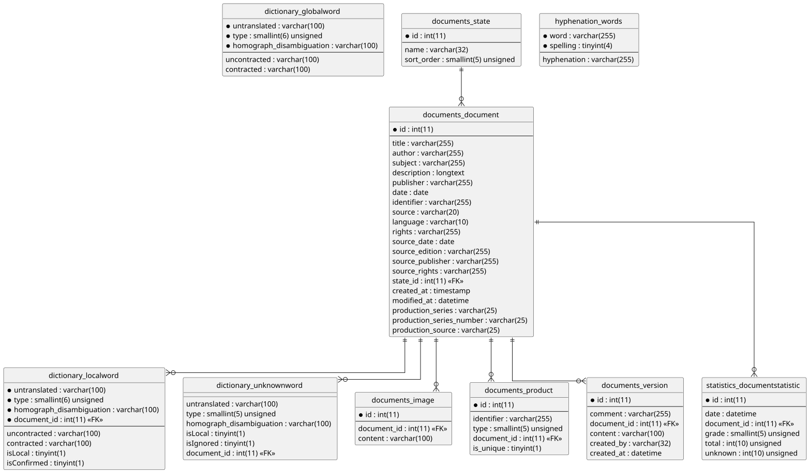

#+title: Database schema

The diagram ([[file:db_schema.puml]]) and the SQL definitions
([[file:db_schema.sql]]) are generated from the live database. To
regenerate them after a schema change:

#+begin_src shell
  export MYSQL_PWD=<password>
  mysql -N -r -h db.sbszh.ch -P 3309 -u <user> <db> < scripts/schema2plantuml.sql > doc/db_schema.puml
  plantuml -tsvg doc/db_schema.puml

  for t in $(mysql -N -h db.sbszh.ch -P 3309 -u <user> <db> -e "SHOW TABLES"); do
    mysql -N -r -h db.sbszh.ch -P 3309 -u <user> <db> -e "SHOW CREATE TABLE $t" | cut -f2 | sed 's/ AUTO_INCREMENT=[0-9]*//; $s/$/;/'
    echo
  done > doc/db_schema.sql
#+end_src

=mysqldump --no-data= would be simpler, but newer MariaDB clients fail
against the 10.1 server (=Unknown column 'generation_expression'=).
