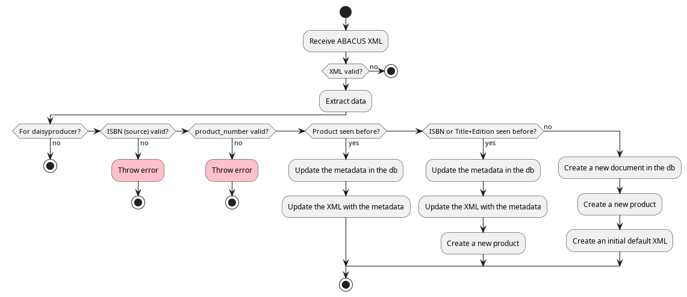
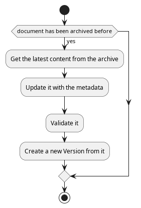

* Terminology

* Procedure
- validate xml
- extract the relevant data
- validate the ISBN
- ignore the file if it is not meant for daisyproducer
- validate the product number
- are there exiting documents with the given product number?
  - yes
    - make sure there is only one document
    - update the metadata in the db
    - update the XML with the new metadata
      - by using a virtual "abacus" user
      - and shelling out to a jar file that implements the XML update
	- ~update-dtbook-metadata.jar~
  - otherwise
    - check if
      - there is a document with the given ISBN
      - or if there is a document with the same title and source_edition
    - yes
      - make sure there is only one document
      - update the metadata in the db
      - update the XML with the new metadata
	- by using a virtual "abacus" user
	- and shelling out to a jar file that implements the XML update
	  - update-dtbook-metadata.jar
      - update the product association
	- i.e. create a product with the given product_number, product_type and document
  - otherwise
    - Looks like the document hasn't been imported before
    - Create a new document and insert it in the db
      - with initial state set to /new/ or /in_production/
	- (/open/)
    - update the product association
      - i.e. create a product with the given product_number, product_type and document
    - Create an initial default XML with the given metadata
      - using a templating engine
      - and the ABACUS user
- (disabled) if the product_number has never been seen before then we
  are talking about a new production, i.e. try to check out the
  document in the archive
- If the order has been archived before fetch the xml from the archive
  - has been archived before
    - find out with a CMIS request
  - yes
    - get the content
      - search the product in the archive
	- using CMIS and the product_number
      - get the the sibling object (via the parents children) with the
	properties ~D:sbs:daisyFile~
      - get the latest version
      - get the content stream, read and close it
    - store the content in a temp file
    - and update the metadata
      - again by shelling out to a jar file that implements the XML
        update
	- ~update-dtbook-metadata.jar~
    - then validate the temp file (why?)
      - fail if invalid
    - Create a new version with that temp file
    - (disabled) update the content in /ueberarbeiten/

* State diagram
** Import
#+begin_src plantuml :file ABACUS_import.png :results file graphics :exports both
  @startuml
    start
    :Receive ABACUS XML;
    if (XML valid?) then (no)
      stop
    endif
    :Extract data;
    if (For daisyproducer?) then (no)
      stop
    elseif (ISBN (source) valid?) then (no)
      #pink:Throw error;
      stop
    elseif (product_number valid?) then (no)
      #pink:Throw error;
      stop
    elseif (Product seen before?) then (yes)
       :Update the metadata in the db;
       :Update the XML with the metadata;
    elseif (ISBN or Title+Edition seen before?) then (yes)
       :Update the metadata in the db;
       :Update the XML with the metadata;
       :Create a new product;
    else (no)
       :Create a new document in the db;
       :Create a new product;
       :Create an initial default XML;
    endif
  stop
  @enduml
#+end_src

#+RESULTS:

** Alfresco synchronization
#+begin_src plantuml :file Alfresco_sync.png :results file graphics :exports both
@startuml
  start
  if (document has been archived before) then (yes)
    :Get the latest content from the archive;
    :Update it with the metadata;
    :Validate it;
    :Create a new Version from it;
  endif
stop
@enduml
#+end_src

#+RESULTS:

* Database Model

See [[file:db_schema.org]] for the current schema.

** Product constraints
- Given an product.identifier there should only be one product.document_id
- product.identifier should be unique
- (product.type, product.document_id) should be unique, except for type 0

The last constraint is implemented with the generated column
=is_unique=, which is =NULL= for type 0, and a unique key on
=(is_unique, type, document_id)=. MariaDB allows any number of rows
with =NULL= in a unique key.
